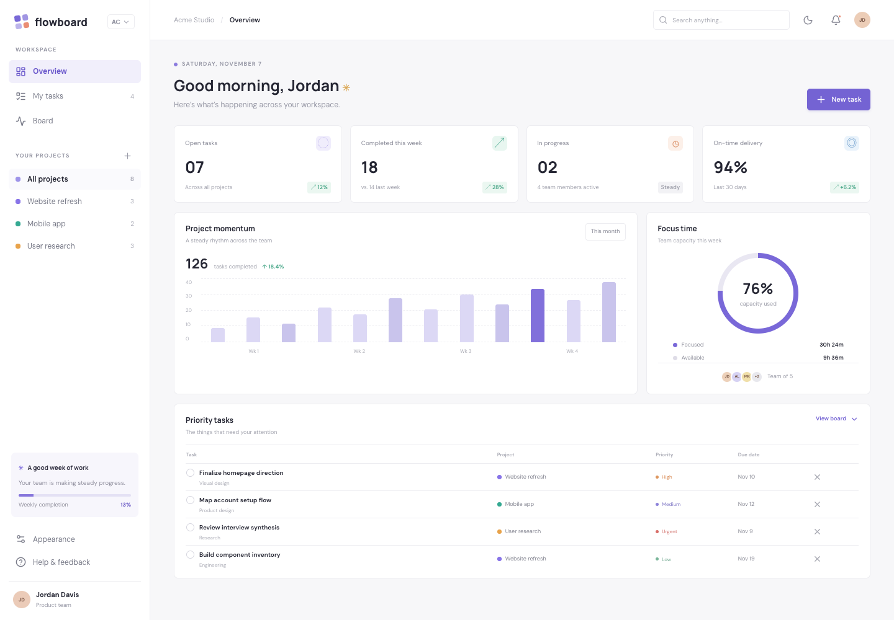
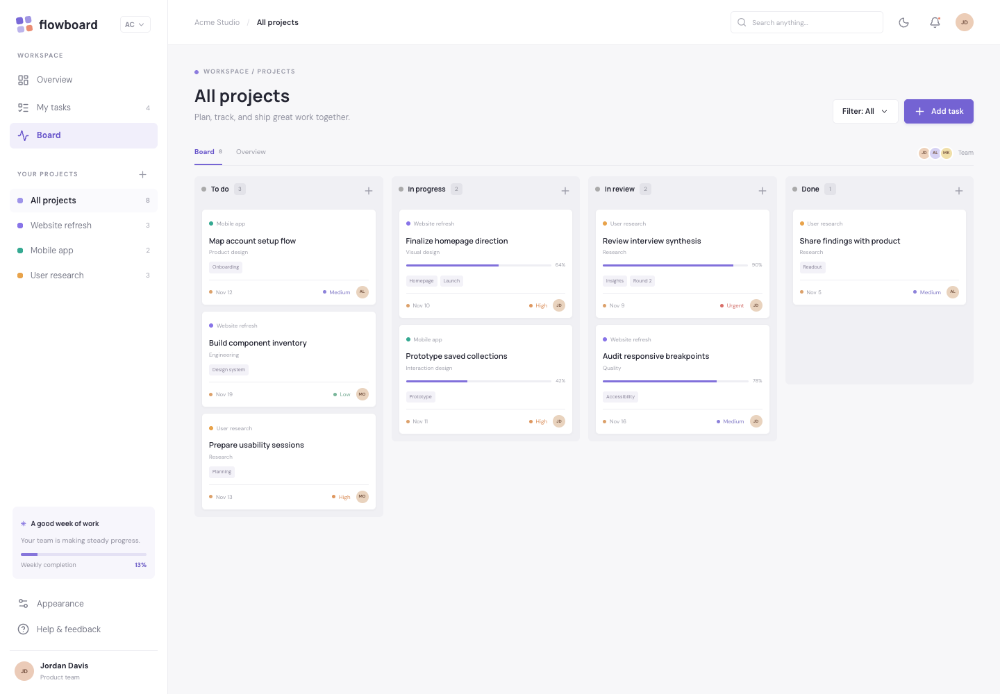
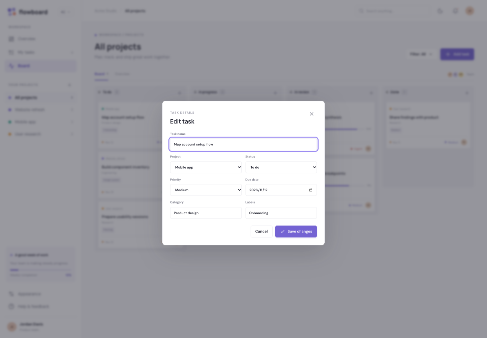
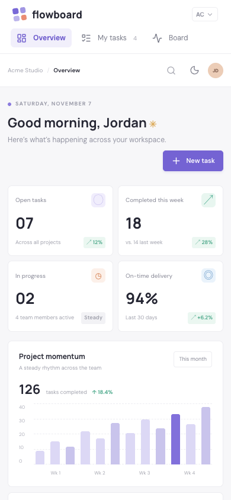

# FlowBoard

A focused project workspace with a delivery dashboard, Kanban board, and persistent task management.


[](https://github.com/RobertGostMontoliu/flowboard/actions/workflows/ci.yml)

[Live demo](https://robertgostmontoliu.github.io/flowboard/) · [Setup](#getting-started) · [Deployment](docs/DEPLOYMENT.md) · [Screenshot gallery](docs/screenshots/README.md)



## Overview

FlowBoard brings a small product team's tasks into one browser workspace. It moves from a high-level overview to project boards and individual task editing, with no account or service setup. The project explores how a compact typed state model can support several useful views without introducing a backend.

## Features

- Workspace overview with open-task counts, in-progress work, and a priority task table.
- Four-column Kanban board with native drag-and-drop and a keyboard-operable status selector on every card.
- Create, edit, and delete tasks with a project, priority, category, labels, due date, and status.
- Search titles, labels, and categories; filter high-priority work; browse individual projects or tasks assigned to you.
- Persist tasks and the light/dark appearance preference in localStorage.

## Screenshots

### Project board

Tasks grouped by status, with project context, priorities, and an alternative to dragging.



### Task details

Edit the same typed task model used by the dashboard and board.



### Mobile

A genuine 390 × 844 browser capture. See the [full gallery](docs/screenshots/README.md) for the remaining views.



## Technology stack

| Layer | Implementation |
| --- | --- |
| UI | React 19 and TypeScript 5.9 |
| Styling | Custom responsive CSS with Tailwind CSS 3.4 and PostCSS |
| Navigation | A typed React state union; no routing library |
| State | React state, memoized derived collections, and a localStorage hook |
| Motion and icons | Motion for React; Lucide React |
| Tests | Vitest 4, React Testing Library, user-event, and jsdom |
| Quality | ESLint, TypeScript project checks, and Prettier |
| Build and hosting | Vite 6; static GitHub Pages deployment through Actions |

There is no backend and no API key configuration. Google Fonts is an external typography dependency.

## Architecture

```text
.github/workflows/ci.yml   Quality checks and Pages deployment
docs/
  DEPLOYMENT.md           Hosting and release instructions
  screenshots/            Real desktop and mobile captures
src/
  App.tsx                 View composition and interactions
  App.test.tsx            User-facing regression tests
  data.ts                 Three projects and seeded workspace tasks
  types.ts                Project, Task, TaskStatus, TaskPriority
  hooks/useLocalStorage.ts
  test/setup.ts           DOM test setup
  index.css               Responsive visual system
  main.tsx                React entry point
vite.config.ts            Repository base path and test environment
```

`App` owns the view, project, search, and dialog state. The task collection and theme use `useLocalStorage`; task counts, progress, and filtered boards are derived from that collection. `TaskCard`, `TaskTable`, `TaskDialog`, and metric components stay beside the workspace shell in `App.tsx`.

This intentionally compact structure keeps the application easy to inspect. Larger screens can be extracted as their responsibilities grow; there is no global state library or service abstraction to configure.

## Getting started

Use **Node.js 22.22.2 or newer in the 22.x line** and npm. `.nvmrc` selects Node 22, which is also used in CI. The dependency engines additionally support Node 24.15+ and 26+.

```sh
git clone https://github.com/RobertGostMontoliu/flowboard.git
cd flowboard
nvm use
npm ci
npm run dev
```

If you do not use nvm, select a supported Node version with your preferred manager and omit `nvm use`. Open the URL Vite prints, normally `http://localhost:5173/flowboard/`.

| Command | Purpose |
| --- | --- |
| `npm run dev` | Start the development server |
| `npm test` | Run automated tests once |
| `npm run test:watch` | Run tests interactively |
| `npm run lint` | Check application and build configuration |
| `npm run typecheck` | Check TypeScript projects |
| `npm run build` | Typecheck and generate `dist/` |
| `npm run preview` | Serve the production build locally |
| `npm audit` | Check dependency advisories |
| `npm run format` | Format project files |

To inspect a production build:

```sh
npm run build
npm run preview
```

Open `http://localhost:4173/flowboard/`. Browser storage is specific to the origin, so development, preview, and the live demo each have independent data. Clear site data to reset the seeded demo.

## Design and user experience

A persistent desktop sidebar separates workspace views from project selection. On smaller screens, navigation becomes a compact horizontal strip, metric cards stack, and the board scrolls horizontally within its container. Status selects provide a keyboard/touch alternative to dragging. Forms have labels and required fields; controls have visible focus styling. The task dialog has an accessible name, but full focus trapping and Escape handling remain future work.

## Technical highlights

- **One task model, multiple views.** Dashboard metrics, project counts, the personal task view, and Kanban columns read from the same task array, avoiding separately synchronized copies.
- **Two ways to move work.** Native drag events and status selects both call the same task transition function; completing a task sets progress to 100%.
- **Derived filtering.** A memoized filter combines project, assignee, text, and priority criteria before tasks are grouped into columns.
- **Storage failure fallback.** The shared hook catches JSON-read and storage-write failures so the session can still operate when browser storage is unavailable.

## Testing and quality

Three interaction tests cover task creation and persistence, status changes through the select control, and text filtering.

The [CI workflow](.github/workflows/ci.yml) installs the lockfile with `npm ci`, runs linting, type checks, tests, a high/critical dependency audit gate, and a production build. Pushes to `main` deploy only after that job passes. Pull requests run checks without deployment permissions.

Browser verification exercises the main user journey, reload persistence, visible image loading, desktop and mobile rendering, and runtime/network errors. Screenshots are actual Chromium captures at 1440 × 1000 and 390 × 844; they are not design mockups. Browser verification was performed for publication and is separate from the committed component-test CI suite.

The Vitest workers disable Node's experimental host Web Storage so tests use jsdom's browser storage. A scoped npm override selects patched `minimatch` for vulnerable tooling versions; the lockfile records the resolved graph. Recheck that override when upgrading the toolchain.

### Known limitations

This is a local frontend demo, not a shared team service. Historical chart values, focus capacity, team identity, notifications, and several metric trends are seeded presentation data. Task counts and completion progress are derived from current tasks. Tasks do not synchronize between people or devices. Views are not URL-addressable. Persisted JSON is parsed defensively but does not yet have runtime schema validation.

Automated tests are focused regression coverage, not a claim of exhaustive testing or WCAG conformance. Storage failures fall back to session state without a visible warning. Web fonts require network access; system fonts provide a fallback.

## Deployment

The configured base is `/flowboard/`. In repository **Settings → Pages**, select **GitHub Actions** as the source. A push to `main` runs quality checks and publishes `dist/` at:

https://robertgostmontoliu.github.io/flowboard/

Navigation changes React state inside the same document, so refreshing this URL works without server rewrites. Refresh resets the active screen; persisted data remains. There are no product/task/destination deep routes. See [deployment details](docs/DEPLOYMENT.md) for forks and alternative static hosts.

## Future improvements

- Validate and migrate stored task data across schema versions.
- Add complete dialog keyboard handling and automated accessibility checks.
- Make search available directly on narrow mobile layouts and give each view a shareable URL.
- Introduce optional authenticated team synchronization and real activity history.

## License

The existing source license is [MIT](LICENSE). Dependencies retain their own licenses. Remote photography and fonts remain subject to their providers' terms; the MIT license does not relicense third-party media.
