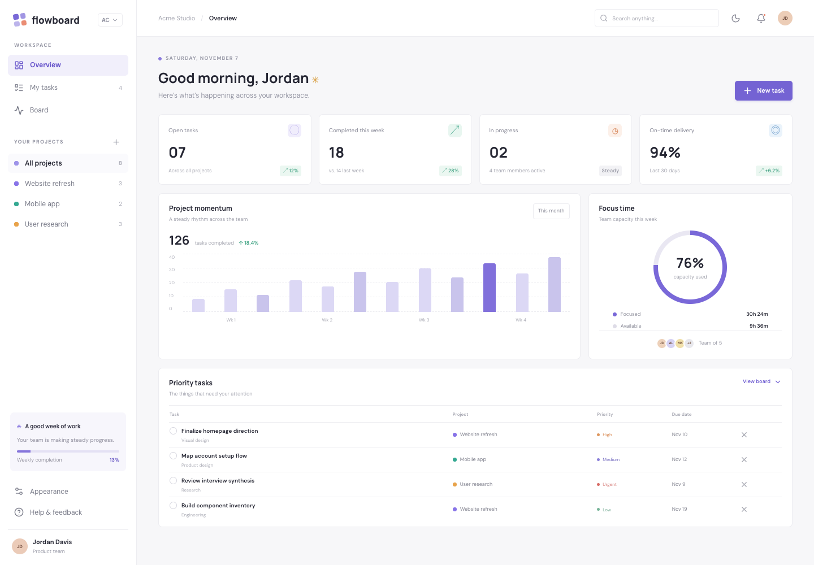
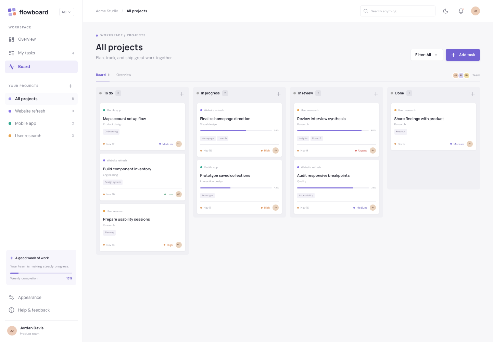
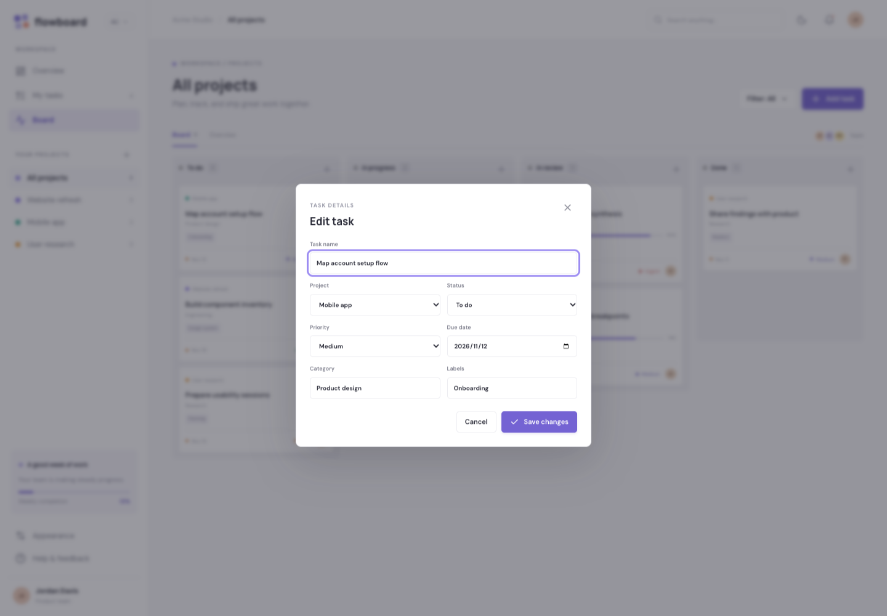
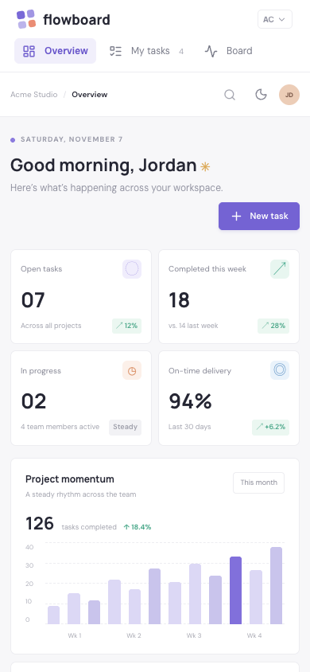

# FlowBoard screenshots

These PNGs are genuine browser screenshots of the running application, captured with Playwright and headless Google Chrome on November 7, 2026. They use the application's seeded demo content and normal UI interactions; no compositing, generated interface imagery, or replacement page content is used.

- Desktop viewport: **1440 × 1000**, device scale factor 1.
- Mobile viewport: **390 × 844**, device scale factor 1, touch/mobile emulation.
- Light color scheme and reduced-motion preference.
- Fonts and visible images finish loading before capture.
- PNG preserves interface text without lossy compression.
- Each app uses a fresh browser context. The populated cart is created using the actual add-to-bag controls.

## dashboard

## kanban

## task details

## mobile

## Reproduce

Install dependencies and run `npm run dev`. Open `http://localhost:5173/flowboard/` in a fresh browser profile, set the viewport dimensions above, and navigate to the corresponding screen. Use Playwright's `page.screenshot({ path, animations: 'disabled' })` after awaiting `document.fonts.ready` and visible image decoding. Capture only the viewport rather than a full-page panorama.

The workspace identity and task content are fictional demonstration fixtures.
